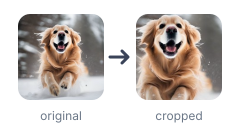
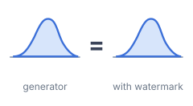
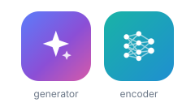

<div align="center">

# Distortion-Free Semantic Watermarks<br>for Black-Box Generative Models

**Aviv Yossef · Or Patashnik · Or Zamir**<br>
Tel Aviv University

<table><tr><td>
<b>TL;DR</b> — A distortion-free, sampling-based watermark for generative models. It needs only black-box access to the generator and to a semantic encoder, so it works with closed image-generation APIs. <i>The watermark is in the choice, not in the pixels.</i>
</td></tr></table>

**[Paper (arXiv)](https://arxiv.org/abs/2611.23208)** &nbsp;·&nbsp; **[Project page](https://avivyossef.github.io/distortion-free-semantic-watermark/)** &nbsp;·&nbsp; **[Encoder weights](https://huggingface.co/avivyossef/semantic-entropy-encoder)** &nbsp;·&nbsp; **[BibTeX](#citation)**


</div>

<table>
  <tr>
    <td align="center" valign="top" width="33%"><br><b>Semantic robustness</b><br><sub>Cropping, resizing and compression change pixels, not what an image depicts, so an edited image keeps the watermark.</sub></td>
    <td align="center" valign="top" width="33%"><br><b>Distortion-free</b><br><sub>Averaged over secret keys, a watermarked output has exactly the generator's own distribution.</sub></td>
    <td align="center" valign="top" width="33%"><br><b>Black-box</b><br><sub>It only requests samples and embeds them, never the weights or internals of the generator or the encoder.</sub></td>
  </tr>
</table>

## How it works

<table>
  <tr>
    <th width="50%">Generation</th>
    <th width="50%">Detection</th>
  </tr>
  <tr>
    <td valign="top">

1. **Sample** *N* images for the prompt.
2. **Map** each image to a semantic region: *M* random hyperplanes over the encoder's embedding give it an *M*-bit code.
3. **Sample a region** from an appropriate distribution, which depends on the secret key and the group sizes to preserve the original output distribution.
4. **Release** one image from that region, unchanged.

</td>
    <td valign="top">

1. **Embed** the suspect image and find its region. Near a hyperplane, the neighbouring region is checked too.
2. **Score** the region with the same secret key.
3. **Compare** with a threshold calibrated on unwatermarked images. Watermarked images are much more likely to score high.

</td>
  </tr>
</table>

<details>
<summary><b>Details: key-dependent selection, boundary-aware detection, the encoder</b></summary>

<br>

**Selection.** The secret key gives each code a pseudorandom score *F*(*c*).
**Gumbel selection** picks the code maximizing log *F*(*c*) / *n*<sub>*c*</sub>,
where *n*<sub>*c*</sub> is its number of candidates, then returns a uniformly random
candidate from that region. Averaged over keys and sampler randomness, each
candidate is returned with probability 1/*N*. The guarantee is over keys; the paper
measures a single fixed key empirically.

**Detection.** The image is turned into a code with the same encoder and
hyperplanes, and the code is scored with the same key. If the embedding is close
to a hyperplane, the **boundary-aware detector** also checks nearby codes and uses
the highest score. For a batch of *B* images from one source, the scores are
averaged before comparing with a threshold calibrated for that batch size.

**The encoder.** It must distinguish independent generations from the same
prompt while keeping each image close to its edited versions; standard semantic
encoders may map those generations close together. We train a DINOv2 encoder
with LoRA to balance separation and stability. The variation among generations
that remains distinguishable after editing is the *semantic entropy* that
selection needs to leave a detectable signal.

</details>

## Quick start

```bash
git clone https://github.com/avivyossef/distortion-free-semantic-watermark.git
cd distortion-free-semantic-watermark
conda env create -f environment.yml
conda activate semantic-watermark
python scripts/download_checkpoint.py --output-dir checkpoints
```

The last command downloads the trained encoder and checks its SHA-256.
Generating and embedding images needs a CUDA GPU. Tree-Ring, Gaussian Shading
and SEAL run in their own environments (`experiments/baselines`).

<details>
<summary><b>Generate, embed and detect on Stable Diffusion 2.1</b></summary>

<br>

Keep keys private (`keys/` is git-ignored). Create a generation-seed key and
a detector key:

```bash
python experiments/generation/new_key.py --output keys/seed.key
python experiments/generation/new_key.py --output keys/detector.key
```

The following clean-detection workflow generates Stable Diffusion 2.1
candidates for a prompt list, embeds them, and evaluates detection.
The prompt list contains JSONL rows with `prompt_uid` and `text` fields.

```bash
python experiments/generation/generate_corpus.py --prompts prompts.jsonl \
    --seed-key-file keys/seed.key --output-dir corpus
python experiments/generation/embed_corpus.py --corpus-dir corpus --prompts prompts.jsonl \
    --encoder ours --checkpoint checkpoints/checkpoint-step-00019840.pt --output-dir embeddings
python experiments/generation/merge_embeddings.py --shards-dir embeddings --output cache.npz
python experiments/clean_detection/run_clean_detection.py --cache cache.npz \
    --key-file keys/detector.key --output-dir clean_detection
python experiments/clean_detection/summarize_clean_detection.py \
    --shards-dir clean_detection --output-dir clean_detection/summary
```

The paper's 1,000 COCO prompts are a release asset:
`python scripts/download_checkpoint.py --asset prompts --output-dir prompts`.

`watermark/` contains keyed scores, hyperplane codes, sampling rules,
boundary-aware detection, and calibration. `encoder/` contains the semantic
encoder. The paper's detector settings are in `configs/detection.yaml`.

</details>

## Reproducing the paper

Each directory under `experiments/` covers one part of the paper; its README
lists the inputs and exact commands. Outputs and measured results vary
across reruns with fresh keys.
For the reported experiments, use the pinned encoder checkpoint. The
[encoder training guide](experiments/encoder_training) documents the paper's
training recipe and the provenance of those weights.

| Paper | Code |
|---|---|
| Semantic encoder and its training | [`experiments/encoder_training`](experiments/encoder_training) |
| Encoder comparison, semantic entropy, stability | [`experiments/encoder_comparison`](experiments/encoder_comparison) |
| SD2.1 candidate corpus | [`experiments/generation`](experiments/generation) |
| Generation quality and diversity | [`experiments/quality`](experiments/quality) |
| Clean detection | [`experiments/clean_detection`](experiments/clean_detection) |
| Detector settings | [`experiments/detector_sweep`](experiments/detector_sweep) |
| Tree-Ring, Gaussian Shading, SEAL | [`experiments/baselines`](experiments/baselines) |
| Robustness to ordinary edits | [`experiments/robustness`](experiments/robustness) |
| Robustness to generative edits | [`experiments/generative_edits`](experiments/generative_edits) |
| Encoder ablation | [`experiments/encoder_ablation`](experiments/encoder_ablation) |
| Alternative sampling rules | [`experiments/sampling_rules`](experiments/sampling_rules) |
| Style versus depth encoders | [`experiments/style_depth_encoders`](experiments/style_depth_encoders) |
| Closed API (GPT Image) | [`experiments/closed_api`](experiments/closed_api) |

CPU tests on synthetic data: `python -m pytest -q tests`.

## Citation

```bibtex
@misc{yossef2026distortionfree,
  title         = {Distortion-Free Semantic Watermarks for Black-Box Generative Models},
  author        = {Yossef, Aviv and Patashnik, Or and Zamir, Or},
  year          = {2026},
  eprint        = {2611.23208},
  archivePrefix = {arXiv},
  primaryClass  = {cs.LG},
  url           = {https://arxiv.org/abs/2611.23208}
}
```

## License

Apache-2.0. The pretrained models used here keep their own licenses.
