<div align="center">

# Distortion-Free Semantic Watermarks for Black-Box Generative Models

**Aviv Yossef · Or Patashnik · Or Zamir**<br>
Tel Aviv University

Paper (coming soon) · [Project page](https://avivyossef.github.io/distortion-free-semantic-watermark/) · Encoder weights (coming soon)



[Step through the animation](https://avivyossef.github.io/distortion-free-semantic-watermark/animation.html)

</div>

This repository implements semantic watermarking by selecting among outputs
from a black-box generator. The method needs only independent samples from
the generator and queries to a semantic encoder, making it applicable to
closed image-generation APIs.

The watermark is *distortion-free*: averaged over the secret detection key
and sampler randomness, a single output has the generator's original
distribution. The guarantee is over keys; the paper measures the quality and
diversity of a single fixed key empirically.
Semantic detection is designed to tolerate content-preserving edits such as
compression, cropping, and resizing.

## Method

For each request, we draw *N* independent candidate images, embed them, and
map their embeddings to *M*-bit codes using fixed random hyperplanes.
A secret key assigns each code a pseudorandom score *F*(*c*).
**Gumbel selection** chooses the code maximizing
log *F*(*c*) / *n*<sub>*c*</sub>, where *n*<sub>*c*</sub> is its number of
candidates, then returns a uniformly random candidate from that group.
Averaged over keys and sampler randomness, each candidate is returned with
probability 1/*N*.

To detect the watermark, we turn the image into a code using the same encoder
and hyperplanes as during selection. We then compute the code's score *F*(*c*)
with the same secret key. If the image embedding is close to a hyperplane,
the **boundary-aware detector** also checks nearby codes and uses the highest
score it finds.

For one image, we compare its score with a threshold calibrated on
unwatermarked images. With a batch of *B* images from one source, we average
their scores before comparing with a threshold calibrated for that batch size.
The experiments use this detector on both unedited and edited images.

The encoder must distinguish independent generations from the same prompt
while keeping each image close to its edited versions. Standard semantic
encoders may map those independent generations close together. We train a
DINOv2 encoder with LoRA to balance separation and stability. The variation
among generations that remains distinguishable after editing is the
*semantic entropy* needed for selection to introduce a detectable signal.

## Installation

```bash
git clone https://github.com/avivyossef/distortion-free-semantic-watermark.git
cd distortion-free-semantic-watermark
conda env create -f environment.yml
conda activate semantic-watermark
python scripts/download_checkpoint.py --output-dir checkpoints   # trained encoder, SHA-256 checked
```

Generating and embedding images needs a CUDA GPU. Tree-Ring, Gaussian Shading
and SEAL run in their own environments (`experiments/baselines`).

## Usage

Keep keys private (`keys/` is git-ignored). Create a generation-seed key and
a detector key:

```bash
python experiments/generation/new_key.py --output keys/seed.key
python experiments/generation/new_key.py --output keys/detector.key
```

The following clean-detection workflow generates Stable Diffusion 2.1
candidates for a prompt list, embeds them, and evaluates detection.
The prompt list contains JSONL rows with `prompt_uid` and `text` fields.

```bash
python experiments/generation/generate_corpus.py --prompts prompts.jsonl \
    --seed-key-file keys/seed.key --output-dir corpus
python experiments/generation/embed_corpus.py --corpus-dir corpus --prompts prompts.jsonl \
    --encoder ours --checkpoint checkpoints/checkpoint-step-00019840.pt --output-dir embeddings
python experiments/generation/merge_embeddings.py --shards-dir embeddings --output cache.npz
python experiments/clean_detection/run_clean_detection.py --cache cache.npz \
    --key-file keys/detector.key --output-dir clean_detection
python experiments/clean_detection/summarize_clean_detection.py \
    --shards-dir clean_detection --output-dir clean_detection/summary
```

The paper's 1,000 COCO prompts are a release asset:
`python scripts/download_checkpoint.py --asset prompts --output-dir prompts`.

`watermark/` contains keyed scores, hyperplane codes, sampling rules,
boundary-aware detection, and calibration. `encoder/` contains the semantic
encoder. The paper's detector settings are in `configs/detection.yaml`.

## Reproducing the paper

Each directory under `experiments/` covers one part of the paper; its README
lists the inputs and exact commands. Outputs and measured results vary
across reruns with fresh keys.

| Paper | Code |
|---|---|
| Semantic encoder and its training | [`experiments/encoder_training`](experiments/encoder_training) |
| Encoder comparison, semantic entropy, stability | [`experiments/encoder_comparison`](experiments/encoder_comparison) |
| SD2.1 candidate corpus | [`experiments/generation`](experiments/generation) |
| Generation quality and diversity | [`experiments/quality`](experiments/quality) |
| Clean detection | [`experiments/clean_detection`](experiments/clean_detection) |
| Detector settings | [`experiments/detector_sweep`](experiments/detector_sweep) |
| Tree-Ring, Gaussian Shading, SEAL | [`experiments/baselines`](experiments/baselines) |
| Robustness to ordinary edits | [`experiments/robustness`](experiments/robustness) |
| Robustness to generative edits | [`experiments/generative_edits`](experiments/generative_edits) |
| Encoder ablation | [`experiments/encoder_ablation`](experiments/encoder_ablation) |
| Alternative sampling rules | [`experiments/sampling_rules`](experiments/sampling_rules) |
| Style versus depth encoders | [`experiments/style_depth_encoders`](experiments/style_depth_encoders) |
| Closed API (GPT Image) | [`experiments/closed_api`](experiments/closed_api) |

CPU tests on synthetic data: `python -m pytest -q tests`.

## Citation

```bibtex
@misc{yossef2026distortionfree,
  title  = {Distortion-Free Semantic Watermarks for Black-Box Generative Models},
  author = {Yossef, Aviv and Patashnik, Or and Zamir, Or},
  year   = {2026},
  note   = {Preprint}
}
```

## License

Apache-2.0. The pretrained models used here keep their own licenses.
